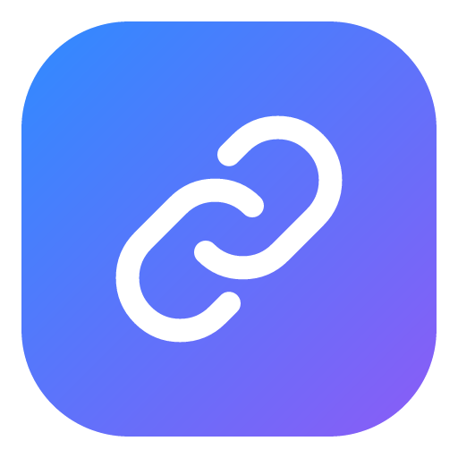
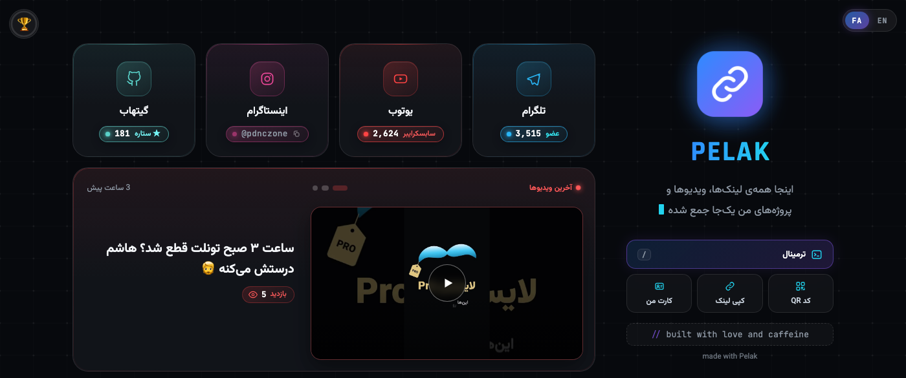

<div dir="rtl" align="center">



# Pelak | پلاک

**صفحه‌ی لینک شخصی خودت؛ متحرک، رایگان، روی کلودفلر و فقط با یک فایل تنظیمات.**

[English](README.md) · [نمونه‌ی زنده](https://pdnczone.ir) · [گزارش مشکل](https://github.com/pdnczone/pelak/issues)

[](https://deploy.workers.cloudflare.com/?url=https://github.com/pdnczone/pelak)



</div>

<div dir="rtl">

## چی داره؟

- کاشی شبکه‌های اجتماعی با آمار زنده: اعضای تلگرام، سابسکرایبر یوتیوب، ستاره‌ی گیت‌هاب
- آخرین ویدیوهای یوتیوب، آخرین پست‌های کانال تلگرام و پروژه‌ی منتخب گیت‌هاب
- هر تعداد لینک دلخواه، با آدرس کوتاه (`your-site.com/website`) و شمارنده‌ی کلیک
- کره‌ی بازدیدکننده‌ها، دفتر یادگاری، ترمینال، بازی مار با جدول رکورد، دستاورد، کارت بازدیدکننده و QR
- کارت حمایت با هدف و برترین حامی‌ها (ریمیت، NOWPayments، ثبت دستی) — اختیاری
- ربات تلگرام مدیریت: گزارش روزانه، بکاپ، مدیریت دونیت و یادگاری — اختیاری
- اورلی OBS برای استریم در آدرس `/overlay`
- فارسی و انگلیسی، یا فقط یکی از این دو
- بدون سرور و بدون دیتابیس. پلن رایگان کلودفلر کافیه.

## نصب

### روش ۱: با یک کلیک (بدون ترمینال)

یک حساب رایگان [کلودفلر](https://dash.cloudflare.com/sign-up) و یک حساب [گیت‌هاب](https://github.com/signup) لازم داری.

1. دکمه‌ی **Deploy to Cloudflare** بالای صفحه رو بزن و مرحله‌ها رو برو. خودش پروژه رو توی گیت‌هابت کپی می‌کنه، فضای ذخیره‌سازی رو می‌سازه و سایت رو بالا میاره.
2. وقتی `STATS_PASSWORD` رو خواست، یک رمز طولانی بذار.
3. توی گیت‌هاب **خودت** ریپوی جدید رو باز کن ← `site.config.js` ← آیکن مداد ← اسم، اکانت‌ها و لینک‌هات رو بنویس ← **Commit changes**.
4. حدود یک دقیقه صبر کن و سایت رو رفرش کن. هر تغییری که کامیت کنی، خودش دوباره منتشر می‌شه.

### روش ۲: با ترمینال

[Node.js](https://nodejs.org) نسخه‌ی ۲۲ به بالا لازمه.

</div>

```bash
git clone https://github.com/pdnczone/pelak.git
cd pelak
npm install
# فایل site.config.js رو ویرایش کن و نتیجه رو روی http://localhost:8787 ببین
npm run dev
# انتشار (بار اول صفحه‌ی ورود کلودفلر باز می‌شه)
npm run check
npm run deploy
npx wrangler secret put STATS_PASSWORD
```

<div dir="rtl">

## شخصی‌سازی

| می‌خوام اینو عوض کنم | این فایل |
|---|---|
| اسم، متن‌ها، لینک‌ها، زبان، رنگ، روشن و خاموش کردن بخش‌ها | [`site.config.js`](site.config.js) |
| لوگو و آیکن تب | فایل [`public/logo.png`](public) رو عوض کن (PNG مربعی ۵۱۲×۵۱۲) |
| عکسی که موقع اشتراک لینک نشون داده می‌شه | فایل [`public/og.png`](public) (۱۲۰۰×۶۳۰) |
| نکته‌های لینوکس (یا هر نکته‌ی دیگه) | [`public/tips.js`](public/tips.js) |
| ظاهر و طراحی | [`public/style.css`](public/style.css)، متغیرها اول فایل هستن |
| ساختار صفحه | [`src/home.html`](src/home.html) |
| رفتار سمت مرورگر | [`public/app.js`](public/app.js) |
| سمت سرور، API و ربات | [`src/worker.js`](src/worker.js) |

اضافه کردن لینک:

</div>

```js
links: [
  { id: "shop", label: { fa: "فروشگاه", en: "Shop" }, url: "https://example.com", icon: "store", color: "250,190,88", handle: "" }
]
```

<div dir="rtl">

مخفی کردن یک بخش:

</div>

```js
sections: { snake: false, map: false }
```

<div dir="rtl">

برنامه‌نویس نیستی؟ پروژه رو بده به یک ابزار هوش مصنوعی (مثل Claude Code یا Cursor) و بگو چی می‌خوای. فایل [`AGENTS.md`](AGENTS.md) پروژه رو براش توضیح می‌ده.

### دامنه‌ی خودت

داشبورد کلودفلر ← **Workers & Pages** ← ورکر ← **Settings** ← **Domains & Routes** ← **Add** ← **Custom domain**.

## مقدارهای محرمانه (همه اختیاری)

از داشبورد کلودفلر (ورکر ← **Settings** ← **Variables and Secrets** ← نوع **Secret**) یا با `npx wrangler secret put NAME` بذارشون. **هیچ‌وقت توی فایل‌های ریپو ننویس‌شون.**

| اسم | کارش |
|---|---|
| `STATS_PASSWORD` | حداقل ۱۰ کاراکتر. ورود به صفحه‌های خصوصی `/stats` و `/admin/guestbook` (نام کاربری مهم نیست) |
| `YOUTUBE_API_KEY` | تعداد دقیق سابسکرایبر، لایک و کامنت. بدون این، صفحه‌ی عمومی خونده می‌شه |
| `GITHUB_TOKEN` | محدودیت کمتر گیت‌هاب. توکن بدون هیچ دسترسی هم کافیه |
| `TELEGRAM_BOT_TOKEN` و `TELEGRAM_CHAT_ID` | توکن ربات از [@BotFather](https://t.me/BotFather) و آیدی عددی خودت |
| `REYMIT_GOAL_URL` و `REYMIT_TOP_URL` و `REYMIT_LAST_URL` | لینک‌های اورلی ریمیت خودت |
| `REYMIT_PROXY` | آدرس پراکسی خودت برای reymit.ir، اگه به کلودفلر جواب نمی‌ده |
| `NOWPAYMENTS_IPN_SECRET` | دونیت کریپتو. آدرس IPN رو بذار `https://YOUR-DOMAIN/api/nowpayments-ipn` |
| `USD_TO_TOMAN` | نرخ پشتیبان؛ معمولاً خودکار گرفته می‌شه |

برای روشن کردن ربات: دو مقدار تلگرام و `STATS_PASSWORD` رو بذار، بعد یک بار `https://YOUR-DOMAIN/api/telegram-setup` رو باز کن و با همون رمز وارد شو.

## آپدیت

</div>

```bash
git remote add upstream https://github.com/pdnczone/pelak.git
git fetch upstream
git merge upstream/main --allow-unrelated-histories
```

<div dir="rtl">

اگه `site.config.js` یا عکس‌ها تداخل داشتن، نسخه‌ی خودت رو نگه دار.

## مشکلات رایج

- **یادگاری یا آمار ذخیره نمی‌شه:** ببین ورکر یک KV با اسم `STATS_KV` داره یا نه (Settings ← Bindings). اگه نداره، یک KV بساز و با همین اسم وصلش کن.
- **آمار خالیه:** اکانت باید عمومی باشه و بدون `@` نوشته شده باشه. آمار هر ۳۰ دقیقه آپدیت می‌شه.
- **نوار حمایت روی صفر می‌مونه:** وقتی تکون می‌خوره که ریمیت یا NOWPayments وصل باشه، با ربات دونیت ثبت کنی، یا مبلغ‌ها رو توی `/admin/guestbook` ویرایش کنی.
- **بعد از ویرایش خراب شد:** دستور `npm run check` رو بزن یا تب **Actions** رو ببین. معمولاً یک ویرگول یا گیومه جا افتاده.

## مشارکت

ایده، رفع باگ و ترجمه خوشحال‌مون می‌کنه. [CONTRIBUTING.md](CONTRIBUTING.md) رو ببین.

## لایسنس

استفاده و تغییر آزاد و رایگان، ولی **غیرقابل فروش**: [PolyForm Noncommercial 1.0.0](LICENSE.md) به‌همراه [اجازه‌های تکمیلی](LICENSE-PERMISSIONS.md).

- ✅ استفاده برای خودت، کانالت یا کسب‌وکار خودت
- ✅ تغییر هر جای کد و انتشار رایگان نسخه‌ی خودت، با نگه داشتن فایل‌های لایسنس
- ⛔ فروش پروژه، یا پول گرفتن برای نصب، میزبانی و سفارشی‌سازی. فقط PDNC می‌تونه بفروشه

</div>
