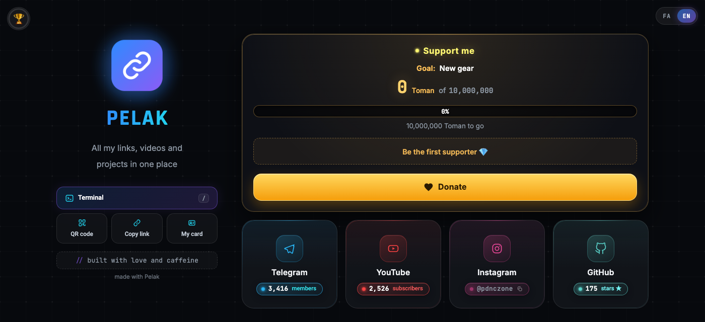

<div align="center">


# Pelak

**Your own animated link page. Free, on Cloudflare, with one config file.**

[فارسی](README.fa.md) · [Live example](https://pdnczone.ir) · [Report a bug](https://github.com/pdnczone/pelak/issues)

[](https://deploy.workers.cloudflare.com/?url=https://github.com/pdnczone/pelak)



</div>

## What you get

- Social tiles with live numbers: Telegram members, YouTube subscribers, GitHub stars
- Latest YouTube videos, latest Telegram posts and a featured GitHub project
- As many extra links as you want, each with a short address (`your-site.com/website`) and a click counter
- Visitors globe, guestbook, terminal, Snake with a leaderboard, achievements, visitor card, QR code
- Optional donation card with a goal and top supporters (Reymit, NOWPayments, manual)
- Optional Telegram bot: daily report, backup, donation and guestbook management (Persian)
- OBS overlay for streams at `/overlay`
- Persian (RTL) and English, or only one of them
- No server, no database to run, no build step. The free Cloudflare plan is enough.

## Set it up

### Option 1: one click (no terminal)

You need a free [Cloudflare](https://dash.cloudflare.com/sign-up) account and a [GitHub](https://github.com/signup) account.

1. Press **Deploy to Cloudflare** above and follow the page. It copies this project to your GitHub, creates the storage and puts the site online.
2. Choose a long password for `STATS_PASSWORD` when it asks.
3. Open the new repository on **your** GitHub → `site.config.js` → pencil icon → put your name, accounts and links → **Commit changes**.
4. Wait about a minute and refresh your site. Every commit is deployed again.

### Option 2: terminal

You need [Node.js](https://nodejs.org) 22 or newer.

```bash
git clone https://github.com/pdnczone/pelak.git
cd pelak
npm install
# edit site.config.js, then look at it on http://localhost:8787
npm run dev
# put it online (the first time it opens a Cloudflare login)
npm run check
npm run deploy
npx wrangler secret put STATS_PASSWORD
```

## Make it yours

| I want to change... | Edit |
|---|---|
| Name, texts, links, languages, colours, parts on/off | [`site.config.js`](site.config.js) |
| Logo and favicon | replace [`public/logo.png`](public) (square PNG, 512×512) |
| Image shown when the link is shared | replace [`public/og.png`](public) (1200×630) |
| Linux tips (or turn them into any other tips) | [`public/tips.js`](public/tips.js) |
| Design | [`public/style.css`](public/style.css), variables are at the top |
| Page structure | [`src/home.html`](src/home.html) |
| Behaviour in the browser | [`public/app.js`](public/app.js) |
| Server side, API, bot | [`src/worker.js`](src/worker.js) |

Add a link:

```js
links: [
  { id: "shop", label: { fa: "فروشگاه", en: "Shop" }, url: "https://example.com", icon: "store", color: "250,190,88", handle: "" }
]
```

Hide a part:

```js
sections: { snake: false, map: false }
```

Not a programmer? Give the repository to an AI coding tool (Claude Code, Cursor, ...) and say what you want. [`AGENTS.md`](AGENTS.md) explains the project to it.

### Your own domain

Cloudflare dashboard → **Workers & Pages** → your worker → **Settings** → **Domains & Routes** → **Add** → **Custom domain**.

## Secrets (all optional)

Set them in the Cloudflare dashboard (worker → **Settings** → **Variables and Secrets** → type **Secret**) or with `npx wrangler secret put NAME`. **Never write them in a file of the repository.**

| Name | What it does |
|---|---|
| `STATS_PASSWORD` | 10 characters or more. Opens the private pages `/stats` and `/admin/guestbook` (any username) |
| `YOUTUBE_API_KEY` | Exact subscriber count, likes and comments. Without it the public page is read |
| `GITHUB_TOKEN` | Higher GitHub limit. A token with no permissions is enough |
| `TELEGRAM_BOT_TOKEN`, `TELEGRAM_CHAT_ID` | Bot token from [@BotFather](https://t.me/BotFather) and your own numeric id |
| `REYMIT_GOAL_URL`, `REYMIT_TOP_URL`, `REYMIT_LAST_URL` | Your Reymit overlay links |
| `REYMIT_PROXY` | Address of your own mirror of reymit.ir, if it does not answer Cloudflare |
| `NOWPAYMENTS_IPN_SECRET` | Crypto donations. Set the IPN address to `https://YOUR-DOMAIN/api/nowpayments-ipn` |
| `USD_TO_TOMAN` | Fallback rate. Normally it is fetched automatically |

To start the bot, set the two Telegram secrets and `STATS_PASSWORD`, then open `https://YOUR-DOMAIN/api/telegram-setup` once and log in with the password.

## Update later

Deployed with one click: in your copy, add this repository as a second remote and merge.

```bash
git remote add upstream https://github.com/pdnczone/pelak.git
git fetch upstream
git merge upstream/main --allow-unrelated-histories
```

On a conflict in `site.config.js` or the images, keep your own version.

## Problems

- **The guestbook or stats do not save:** check that the worker has a KV binding named `STATS_KV` (Settings → Bindings). If not, create a KV namespace and bind it with that name.
- **Numbers are empty:** the account must be public and written without `@`. Numbers refresh every 30 minutes.
- **The donation bar stays at 0:** it moves when Reymit or NOWPayments is connected, when you add a donation with the bot, or when you edit the amounts in `/admin/guestbook`.
- **The page is broken after an edit:** run `npm run check`, or look at the failed check in the **Actions** tab. It is usually a missing comma or quote.

## Contributing

Ideas, fixes and translations are welcome. See [CONTRIBUTING.md](CONTRIBUTING.md).

## License

Free to use and change, **not for sale**: [PolyForm Noncommercial 1.0.0](LICENSE.md) with [additional permissions](LICENSE-PERMISSIONS.md).

- ✅ Run it for yourself, your channel or your own business
- ✅ Change anything, and share your version for free with the license files kept
- ⛔ Selling it, or charging for its setup, hosting or customisation. Only PDNC may sell it
